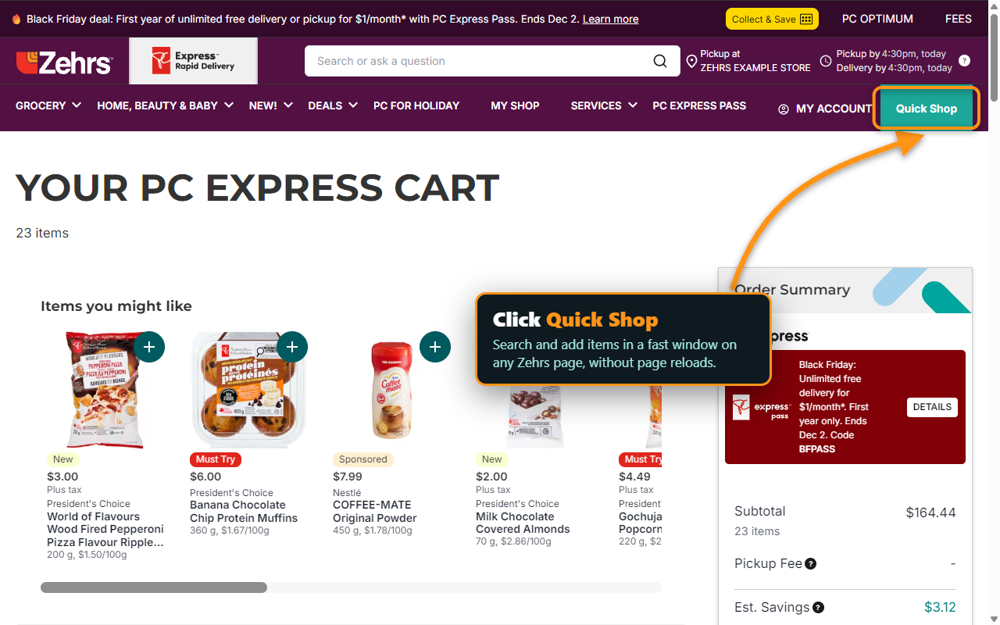
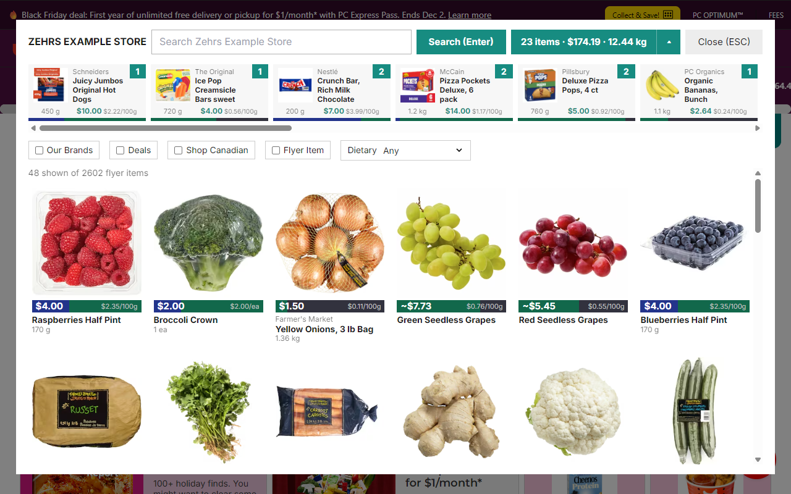

# Quick Shop

**Bug fixes and pull requests are welcome. New features are probably better done in a fork.**

Quick Shop is a Chrome extension for zehrs.ca. It adds a "Quick Shop" button to the site's navigation bar that opens an in-page window for searching products and changing cart quantities, without page reloads. Changes go to your real Zehrs cart, through the same API requests the site itself makes.





## Features

- Search, with the site's quick filters (Our Brands, Deals, Shop Canadian, Flyer Item, Dietary). Opens on the weekly flyer items.
- Add and remove items from the results or from a row of what's already in your cart. Cart saves are batched a few seconds after you stop clicking.
- Cart summary with item count, total price, and total weight.
- A cost-per-100 g bar on every price.
- Product details with a large image, and previous / next.
- Keyboard use: type anywhere to search, Tab between products, ↑ / ↓ to change quantity, Enter for details, ← / → between details, Esc to close.

## Building and running it yourself

You need [Node.js](https://nodejs.org/) and [Yarn](https://classic.yarnpkg.com/).

```
yarn install
yarn build-extension-prod
```

Then load it in Chrome:

1. Open `chrome://extensions`.
2. Turn on **Developer mode**.
3. Click **Load unpacked** and pick the `build-extension-prod` folder.
4. Open any zehrs.ca page, pick a store if you haven't, and click **Quick Shop** in the navigation bar.

### Development build with hot reload

```
yarn watch-extension
```

This builds into `build-extension` and starts a small local server on port 9878. Load `build-extension` as an unpacked extension instead of `build-extension-prod`. After editing code, run `yarn reload-extension` to rebuild; the extension and the open zehrs.ca tab reload by themselves. The development build is the only one that talks to localhost; the production build checks that it contains no localhost code.

### Other scripts

- `yarn type`: type-check.
- `yarn package-extension`: build production and zip it as `quick-shop.zip` for the Chrome Web Store (uses Windows' built-in `tar`).
- `yarn make-icons`: regenerate the icons in `assets/`.

## How it works

The extension runs a script in the page's own context on zehrs.ca. It calls the site's PC Express API with the request headers produced by the site's own code (found in the page's loaded modules at runtime), so nothing site-specific like API keys is hardcoded. The endpoints and how the headers are obtained are documented in [docs/zehrs-api.md](docs/zehrs-api.md); the design is in [spec.md](spec.md).

## Privacy

Quick Shop collects no data. See [PRIVACY.md](PRIVACY.md).
